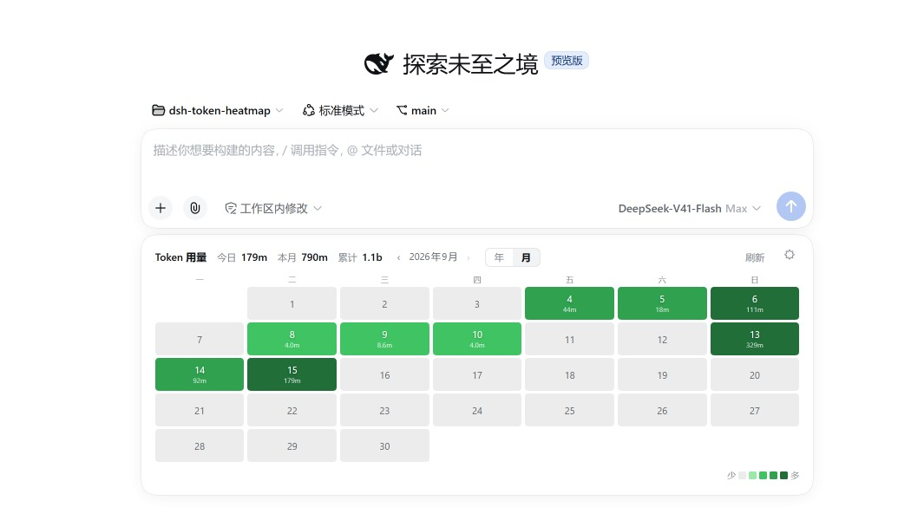
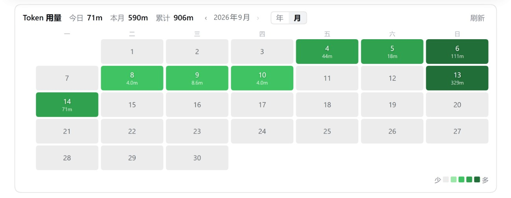
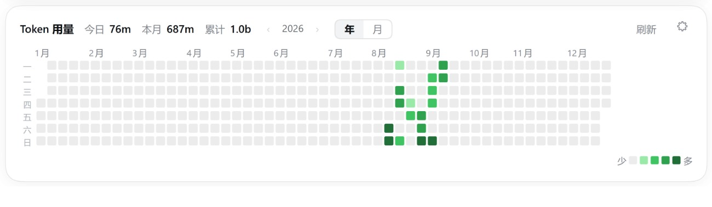
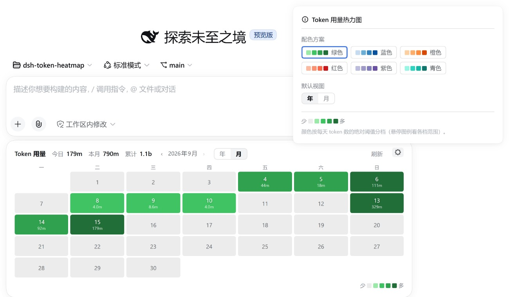

# dsh-token-heatmap

DSH Web GUI 插件：在**新会话（hero）屏幕的输入框下方**显示一个 GitHub 风格的 token 用量热力图 —— 可在**年视图（当前自然年 1月–12月）**与**月视图（单月日历，逐日数值）**之间切换，颜色深浅表示用量多少；同一行展示**今日 / 本月 / 累计** token 用量。**所有设置都在卡片自己身上**（⚙），不在 DSH 设置里。

A DeepSeek Harness web plugin: a GitHub-style daily token-usage heatmap rendered **below the composer input card on the new-session screen only**, switchable between a **calendar-year grid (Jan–Dec)** and a **single-month calendar with per-day numbers**, with today / this-month / all-time totals on the same line. **The card configures itself** (⚙) — nothing lives in DSH settings.

## 界面 / What you get

新会话屏幕输入框正下方出现一张统计卡（**只在新会话显示**；已对话的会话不显示）：



### 月视图 / Month view



单月日历：7 列（周一起，表头一~日）× 5–6 行，每格显示**日号 + 当日 token 数**（如 `4 44m`），底色沿用同一套绝对阈值配色，一眼看出这个月哪几天在烧 token；周末列有浅色底以便区分。标题行的 `‹ 2026年9月 ›` 按**月**步进（最新到本月，最早到有数据的第一天）。

### 年视图 / Year view



GitHub 风格自然年热力图：覆盖所选自然年 1月–12月（`‹ 2026 ›` 按**年**步进，最多到当前年），列为周（周一起），行为星期（左侧标注一~日全部 7 天）；顶部月份标签按列跨度标注（左侧与格线对齐），今日之后的日期显示为空格。

### 共同特性 / Shared

- 🔀 **年 / 月切换**：标题行里的分段按钮即时切换视图（在 `‹ ›` 步进器右边，跟着它一起管当前视图）；`刷新` 与 **⚙** 在行的最右端。
- 🎨 **六套配色**：绿色（经典 GitHub 风格）、蓝色、橙色、红色、紫色、青色，点卡片上的 **⚙** 切换（见下）；颜色按**绝对阈值**分档（按天 token 数，非相对排名）：0 / <1M / 1M–10M / 10M–100M / ≥100M 共 5 级，卡片右下角图例悬停显示各档范围；61M/天 显示为第 3 级。悬停任意格子（年视图的 10px 格子或月视图的日期格）显示日期与精确 token 数。
- 🔢 **统计行**（与标题同一行）：今日 / 本月 / 累计，悬停显示完整数值；本月/累计与当前视图无关，始终是实时值。
- 🔄 自动每 5 分钟刷新，窗口重新可见时也会刷新；行尾可手动刷新。

### 卡片设置 / In-card settings



- ⚙️ **设置就在卡片上**：点标题行最右端的 **⚙**（`刷新 [⚙]`）弹出**悬浮设置面板** —— 位置在 ⚙ 正上方 8px、水平居中对齐、贴边留 12px，超出视口会自动钳制；点面板外的任意位置、按 **Esc**、或再点一次 ⚙ 都会收起。**插件不再往 DSH 设置（设置 → 插件 → 插件配置）里注册任何卡片**，所以那里看不到本插件。
- **配色方案**：六个色板按钮，**点击即时生效**（不需要"保存"）；**默认视图**：年 / 月，决定新会话页面首次打开时显示哪个视图（当次会话手动切换只影响当前页面）。面板底部是阈值图例（悬停看各档范围）与一行说明。
- 写入失败时面板底部会红字提示"保存失败，已回到服务端的值"（settings scope 复核后回滚乐观值）。
- 配置作为**本插件的 profile 配置**持久化：DSH 0.2.0 用插件导出的 `Config` schema 生成设置表单，表单以 **profile entry id**（`token-heatmap`）为键，值写进 profile patch（旧的 `<DSH_HOME>/settings.yaml` 段与 0.1.1 及更早的 `<DSH_HOME>/storages/token-heatmap-config.json` 都会在启动时**一次性迁移/抢救**回配置）。⚠️ **两个字段必须带 `.volatile()`**：DSH 只从 schema 的 volatile 子树生成表单，全是普通字段的条目会被 `settings.describe()` 整个丢弃、`settings.update()` 则抛 `Plugin entry "token-heatmap" has no volatile fields`——两种情况下 ⚙ 面板都只会静默回落到默认值（即"设置不生效"）。

## 安装 / Install

需要 `web` profile 与 `pnpm`。DSH 兼容版本见下方「兼容性 / Compatibility」；运行于 `@deepseek-ai/dsh ^0.2.0-rc.2`（0.2.0 版本线；0.1.2 线请用 0.4.2）。

从 npm 安装：

```powershell
dsh plugin --profile web add @kidli1412/dsh-token-heatmap
```

从 GitHub 安装：

```powershell
dsh plugin --profile web add github:KIDLi1412/dsh-token-heatmap
```

本地开发（手动，本地链接）：

```powershell
dsh plugin --profile web add "link:path/to/dsh-token-heatmap"
```

安装完成后**重启正在运行的 `dsh web`**，并在浏览器中硬刷新（Ctrl+Shift+R）。侧边栏无新增入口——统计卡直接出现在新会话输入框下方。卸载：

```powershell
dsh plugin --profile web remove @kidli1412/dsh-token-heatmap
```

## 工作原理 / How it works

- **服务端**（`lib/index.js` + `lib/usage.js` + `lib/config.js`）：作为 profile bundle 挂载，**实时折叠会话事件**（监听官方 `session/event`，每个 `assistant/chunk`/`assistant/message` 的 `usage` 事件即时写入缓存，不依赖 hero 屏挂载）；启动时一次性补折叠已存在的 live 会话（如 resumed 会话）；请求时 `collectUsage` 再做一次增量同步兜底，并枚举 **已归档（stored）会话**补齐历史——两种 `sessionPersistence` 接口都支持：0.1.2 线的 `listSnapshots()` + `readFrom()`，以及 0.1.3 起取代它们的 `list()` + `open()`/`handle.read()`。同 `(turn, step)` 的重复样本按"替换"语义处理，归属后一天；**fork（`isSeeded`）会话从它的继承切点开始折叠**——日志开头那批属于父会话的事件在父会话侧已折叠，跳过它们才不会把同一批 token 计两次；按天、按模型聚合，缓存到 `<DSH_HOME>/storages/token-heatmap-cache.json`（**跨进程复用**：revision 证明"这份日志没变"就完全跳过、只有追加时才折新尾巴、重写才从切点重建，见 0.5.2 条目）。通过回环受限端点 `GET /api/token-heatmap/usage` 提供；显示配置（配色 + 默认视图）由**导出的 `Config` schema** 持有（0.2.0 的设置模型：以 entry id `token-heatmap` 为键的表单，值写进 profile patch），`GET/POST /api/token-heatmap/config` 作为回环兼容 API 读写同一份配置（读经 `settings.describe()`，写经 `settings.update()`；0.1.x 的 `enabled` 开关已废弃，该字段只作为常量 `true` 回给旧客户端），0.1.1 及更早的 `token-heatmap-config.json` 文档在启动时一次性迁移。
- **客户端**（`lib/client.js`）：手写 `__ModuleLoader__` bundle，注册进会话 `conversation.input.dock` 列表插槽，仅在 `session.blank`（新会话 hero 屏；旧宿主回退 `composerPhase === "blank"`）时渲染——卡片没有显示开关，hero 屏上始终显示。框架真正的"卡片下方"插槽 `conversation.composer.dock` 在 hero 屏被 `!hero` 门控禁用，因此本插件利用 `input.dock` 容器（flex 列）的 CSS `order` 把自己排到输入卡片**之后**。同一份数据由 `buildGrid()`（年，53 列 × 7 行）与 `buildMonthGrid()`（月，7 列 × 5–6 行，带日号）两个纯函数分别铺格，共用 `levelOf()` 的绝对阈值分档与 `palette` 配色；`‹ ›` 按钮按当前视图步进年或月，边界取"当前年/月"与"数据里最早的月"，年/月分段按钮紧跟在步进器后面，**⚙ 设置面板**在卡片底部展开（内嵌面板，动作：⚙ 切换 / × / Esc / 焦点移出）。**不注册 `settings.plugin.item`**（官方"插件配置"页签只渲染"Host 实际 serve 的 namespace ∩ 客户端已注册 key"的卡片，本插件不再占这个位置），配置经 `ctx.configForms.get("token-heatmap")` 读写本插件配置（0.2.0 的设置模型，取代 0.1.x 的 settings scope）。
- 语义与 `dsh-token-meter` 的 `tokenUsage` 投影一致（参考插件 [dsh-usage-stats](https://github.com/Ychris12138/dsh-usage-stats)，MIT）。

## 说明 / Notes

- 仅回环地址可访问数据端点，凭据不外发；插件只读，不修改任何会话数据。
- 无会话/无工作区时（`input.dock` 需要会话上下文）统计卡不渲染。
- 服务端与客户端都随 `dsh web` 启动加载，因此新增/更新插件后需要重启。

## 兼容性 / Compatibility

- **DSH**：manifest 通过 `dsh.compatibility.dshReleases` 把验证过的版本 `0.2.0-rc.2`、`0.2.1-rc.2`、`0.2.1-rc.5`、`0.2.2-rc.4` 都声明为 `compatible`（DSH STORE 的精确逐版本兼容证据；仅范围声明不会恢复上架）。插件使用的客户端注入（`dsh-api-remotes` / `dsh-client-connection` / `dsh-client-locale` / `dsh-client-ui-conversation` / `dsh-client-ui-settings`）、客户端服务（`slots` / `locale` / `configForms`）与 Host 服务（`webServer` 精确路由、`settings.describe` / `settings.update`、`sessions`、`sessionPersistence`）在 0.2.0 / 0.2.1 / 0.2.2（含 rc.4、rc.5）三条版本线上均已在真实安装或安装包中逐项核对（走查见下）。
- **Node**：`^22.19.0 || >=24.0.0`（与 DSH 一致）。
- **宿主要求（dsh-market 显示）**：`engines.dsh: ^0.2.0-rc.2 || ^0.2.2-rc.4`，并将运行时依赖的 lockstep 宿主包声明为 `peerDependencies`（`dsh-host-webserver` / `dsh-session` / `dsh-session-persistence` / `dsh-settings` 与客户端模块 `dsh-api-remotes` / `dsh-client-connection` / `dsh-client-locale` / `dsh-client-ui-conversation` / `dsh-client-ui-settings`，同样各写 `^0.2.0-rc.2 || ^0.2.2-rc.4`）；插件市场会据此显示"宿主要求"并判断与当前 DSH 是否匹配。第二段范围在语义上是冗余的（`^0.2.0-rc.2` 本就覆盖整个 0.2.x），但**把验证过的版本线显式写出来**才是市场和闸门要读的那份声明——0.2.1 起兼容性判定优先只看 `engines.dsh`，声明了它就完全不再看 peer。这些包由 DSH 运行时提供、本插件**从不 import**，所以同时标为 `peerDependenciesMeta.optional`——npm/pnpm 不再把它们装进依赖树（0.2.0 起它们彼此还有 peer 关系，沿用旧的自动安装会直接解析冲突），而"宿主要求"的语义不受影响。
- **依赖**：`@deepseek-ai/schemastery ^3.18.2`（唯一的真实依赖；`dsh-settings` 自 0.2.0 起不再需要作为 peer 之外的运行时依赖）。
- **0.5.0（DSH 0.2.0 适配）**：DSH 0.2.0 换了三套契约，宿主兼容闸门会**直接拒绝挂载**声明不符的 bundle（现象：插件在市场里显示"不兼容"、`rows: []`、hero 屏上什么都没有）——
  1. **宿主要求必须落在 0.2.0 线上**：闸门逐条比对 `peerDependencies` 里的 `@deepseek-ai/dsh*` 与运行时版本（`semver.satisfies(..., { includePrerelease: true })`），`^0.1.2-rc.1` 不满足 `0.2.0-rc.2`，因此本版把 `engines.dsh` 与 9 个宿主 peer 一起提到 `^0.2.0-rc.2`（并把宿主包标为 optional peer，见上）。
  2. **设置模型重做**：0.1.x 的"插件自建 settings namespace + `settings.register(ns, schema)`"没了，`settings.get(ns)` 也没了。现在**插件导出的 `Config`（schemastery）就是设置表单**，以 **profile entry id**（bundle patch 里的 `id: token-heatmap`）为键；Host 侧读别人用 `settings.describe()`（`serveConfig()` 已改，否则配置端点会静默回默认值）、写自己用 `settings.update(ns, patch)`，浏览器端用 `ctx.configForms.get("token-heatmap")`（`getSnapshot` / `subscribe` / `set`），旧的 `ctx.settingsScope.bind({namespace})` 已从客户端消失。卡片 ⚙ 面板的 UI 与"点击即时生效"完全不变。
  3. **弹层皮肤同步**：0.2.0 的原生 stat dialog 改用 `border-radius:var(--dsw-radius-lg)` 并加 `backdrop-filter:var(--dsw-menu-backdrop-filter)`，本插件的 ⚙ 悬浮面板跟着改（带 fallback，旧宿主仍渲染 12px 圆角）。
  > 升级时会**自动抢救旧配置**：DSH 自己的 `settings.yaml` 导入按 entry id 进行，而当时本插件正因上面的 peer 不符被拒挂载，导入失败后值只留在 `~/.dsh/settings.yaml.imported` 里。本版 Host 在启动后（等 Loader settle）读一次该文档，若条目还没有用户值就把非默认的 `colorScheme` / `defaultView` 写进配置——一次性、只读、失败即跳过。（`enabled` 字段自 0.3.0 起已废弃，不参与抢救。）
  > 另外提醒：0.2.0 给 `dsh web` 的每个请求加了**签名 cookie 鉴权**，插件的两个端点因此只有带 cookie 的同源页面能到达；用 node/curl 直接探端点拿到 401 是 DSH 的鉴权层，**不代表插件没挂载**。Host 侧的 loopback 精确路由 fence 保留为第二道防线。
- **0.5.1（⚙ 面板"设置不生效"修复）**：0.5.0 忘了给 `Config` 的字段加 `.volatile()`，而 0.2.0 的设置表单**只认 volatile 字段**——`volatileForm(schema)` 返回 `undefined` 时 `describe()` 直接 `return []`（条目从设置里消失），`write()` 抛 `Plugin entry "token-heatmap" has no volatile fields`。因此 `colorScheme` / `defaultView` 的写入全部被拒，⚙ 面板每次都回落到默认的绿/年视图（点了没反应、刷新后复原）。本版给两个字段补上 `.volatile()`，并让 `entryConfig()` 把 volatile 解析出来的 cosmokit 引用（`{ get() }`）解包成普通值——DSH 自己的 `describe()` 已经这么做了（`plainConfig`），但直接把 `Config(...)` 结果当普通对象读会拿到包装器、同样静默回落到默认值。回归防线：`scripts/settings-smoke.mjs` 复刻了 `volatileForm()` / `isVolatilePath()` 门控，`scripts/smoke.mjs` 的假 settings 服务也照 DSH 的契约拒绝"无 volatile 字段"的条目与 volatile 子树之外的字段。
- **0.4.0（设置搬进卡片）**：不再注册官方 `settings.plugin.item` 插槽——设置页（设置 → 插件 → 插件配置）里不再有本插件的卡片，配色与默认视图改在卡片自己的 ⚙ 面板里改，**点击即时生效**（去掉了草稿/保存/放弃那套）。当时 Host 侧的 `settings.register("token-heatmap", schema)` 保留下来当 settings.yaml 的校验与持久化管道；**该注册在 0.5.0 已随 0.2.0 的设置模型一起移除**（导出的 `Config` 就是管道）。升级只影响设置入口位置，已有配置不动。
- **0.5.5（同步 DSH 0.2.2-rc.4）**：DSH 更新到 `0.2.2` 线（本机 `0.2.2-rc.4`），**插件代码依然不需要改**。这是自 0.2.1 以来第一个带插件相关变更的版本：Cordis 升到 **4.1.0**（Loader 1.1.0 / Include 1.1.0，配置访问统一）、**Session Projection 注册改为异步**、tools 的 `resolve`/`executable` 与 `tools.mode` 迁移、`agent.model` 取代在 `agent/request` 里改 route——本插件不注册 projection、不碰 tools/agent 层，都不涉及；设置管道（`settings.describe()` / `volatileForm` / `isVolatilePath` / `plainConfig`）与 schemastery `.volatile()` 在 Cordis 4.1.0 + schemastery 3.19.0 上行为不变。静态核对：9 个宿主包全部 `0.2.2-rc.4`，5 个客户端包仍声明 `dsh.client`(web)，前端模块表仍有 `react` / `react/jsx-runtime` / `react-dom` / `react-dom/client`，`conversation.input.dock` / `configForms` / `session.blank` / `session/event` 与 `sessionPersistence` 的 `list()`+`open()`+`read()` 全在；`dsh-app-boot@0.2.2-rc.4` 的闸门对 `0.2.2-rc.1` / `rc.4` / `rc.5` 全判 COMPATIBLE。声明同步：`engines.dsh` 与 9 条宿主 peer 的后缀换成 `^0.2.2-rc.4`（第一段 `^0.2.0-rc.2` 不动），`dshReleases` 追加 `"0.2.2-rc.4": "compatible"`。
- **0.5.4（同步 DSH 0.2.1-rc.5）**：DSH 从 `0.2.1-rc.2` 升到 `0.2.1-rc.5`，**依然不需要改代码**。rc.3 / rc.4 / rc.5 三个 RC 的发布说明里只有 UI 与 ACP 修复（侧栏与会话视图的「更多」菜单、新建会话草稿丢失、模型列表刷新方式、ACP 模式下诊断输出混进 stdout、思考内容展示），没有插件契约变化。rc.5 实测：9 个宿主包全部是 `0.2.1-rc.5`、5 个客户端包仍声明 `dsh.client`（web）、前端模块表仍提供 `react` / `react/jsx-runtime` / `react-dom` / `react-dom/client`，运行中的宿主（commit `d4db512`）照常加载本插件两半（客户端 bundle 200 / rev `f6cf91d5a8fb`，`/api/token-heatmap/usage` 与 `/api/token-heatmap/config` 均 200），`npm test` 全绿。同步只动声明：`engines.dsh` 与 9 条宿主 peer 的后缀从 `^0.2.1-rc.2` 换成 `^0.2.1-rc.5`（第一段 `^0.2.0-rc.2` 不动，仍覆盖 rc.2–rc.4），并在 `dsh.compatibility.dshReleases` 追加 `"0.2.1-rc.5": "compatible"`。预检（`temp/compat-preflight.mjs`，闸门取自 `dsh-app-boot@0.2.1-rc.5`）：`0.2.1-rc.2` / `0.2.1-rc.5` / `0.2.1` / `0.2.2-alpha.2` 全部 COMPATIBLE。
- **0.5.3（DSH 0.2.1 复核 + 依赖声明补齐）**：本机 DSH 从 `0.2.0-rc.2` 更新到 `0.2.1-rc.2` 后逐项走查，**插件代码无需改动**，只补齐了给 dsh-market / STORE 读的那份声明。走查结论：`webServer.register` / `settings.describe()` / `settings.update()` / `sessions.list()` + `session.seq` / `eventAt(seq)` / `inheritedEventCount` / `header.isSeeded` / `sessionPersistence.list()` + `open(id,"read")` / `handle.read()` 在 0.2.1-rc.2 都仍在；5 个客户端注入包仍声明 `dsh.client`（web），前端模块表仍提供 `react` / `react/jsx-runtime` / `react-dom` / `react-dom/client`；`session.blank`、`configForms`、`conversation.input.dock` 均仍在；运行中的 0.2.1-rc.2 宿主上两个端点照常应答、`session/event` 折叠照常写入缓存。0.2.1 的插件相关变更里只有一条**需要动作**：**兼容性判定改为优先只看 `engines.dsh`**（0.2.1-rc.1 发布说明："第三方插件的版本兼容性优先按 `engines.dsh` 判断；未声明时沿用原有规则。插件作者需检查声明是否覆盖支持的 DSH 版本"）——因此把 `engines.dsh` 与 9 条宿主 peer 从 `^0.2.0-rc.2` 写成 `^0.2.0-rc.2 || ^0.2.1-rc.2`（语义等价，但显式列出两条版本线），并在 `dsh.compatibility.dshReleases` 补上 `"0.2.1-rc.2": "compatible"`。其余同批变更与本插件无关：输入区统计扩展拆成 `activity` / `usage`（要改的是替换旧 `stats` 整行的插件，本插件用的是 `conversation.input.dock`）、移除运行时 invariant 插件与各包 `./invariant` 导出、子路径插件不再读独立 `package.json`。预检证据（`temp/compat-preflight.mjs`，直接调用宿主自己的闸门）：`0.2.0-rc.2` / `0.2.1-rc.1` / `0.2.1-rc.2` / `0.2.1` / `0.2.0` 全部 COMPATIBLE，`0.1.5-rc.2` 正确拒绝；按 dsh-market 自己的推导（`dshmarket/lib/discovery-compatibility.js`）两条版本线都是 `compatible`，"宿主要求"显示 `^0.2.0-rc.2 || ^0.2.1-rc.2`。**注意**：市场与 STORE 读的是 npm 上的清单，声明要生效需推送 `v0.5.3` tag 走发布流程。
- **0.5.2（stored 日志不再"每次重开都重建缓存"）**：0.2.0 的 jsonl 后端给 pre-v4 日志的 revision 是 `${fileRevision}:${historicalCorpusRevision}`，而后者是**遍历全部会话文件 stat 算出的 sha256**——任何会话一追加（包括你正在聊的那个），所有 pre-v4 会话的 revision 就同时失效（实测本机 181 个缓存会话里 124 个共享同一个语料哈希，对应 44 MB 日志）。旧实现把"revision 变了"一律当成"这份日志变了"，且增量游标差了一位（过滤器从 `consumed` 起、连续性判定却要求 `consumed + 1`），于是**每次重启/刷新都把 124 份日志各读两遍、从零重折**。现在：① 能**证明**文件未变（revision 前缀 `dev:ino:size:mtimeNs` 相同、只有尾部语料摘要变化）就完全不读；② 真正的追加只折 `seq > consumed` 的新尾巴；③ 变短、中间缺号、同长度重写仍保守地从切点重建，且不再重复读取（首次读取的事件直接复用）；④ 无法识别的 revision 形状（如内存后端的 `memory:<name>:<counter>`）只会多读一次，绝不会"跳过而变陈旧"。回归防线：`scripts/cache-reload-smoke.mjs` 用 0.2.0 真实的 revision 形状跑 9 个场景，每个场景都与"从零折叠"的结果逐字段比对。
- **0.1.4（DSH 0.1.2 适配）**：rc.1 起 live session 不再携带 `.events` 数组（改用 `session.seq` + `session.eventAt(seq)`，与官方 `dsh-token-meter` 相同），新会话判断从 `composerPhase === "blank"` 改为布尔 `session.blank`；`sessionPersistence` 的 stored 会话枚举在 0.1.3-alpha.2 被替换（`listSnapshots`/`readFrom` → `list()` + `open()`/`handle.read()`），两条接口见 0.1.6 条目。客户端注入模块列表同步为新架构模块（见上）。
- **0.1.6（session/event 实时折叠 + stored 会话枚举修复）**：`apply()` 注册官方 `session/event` 监听器，每个 usage 事件即时折叠进缓存，解决 live 会话仅在 hero 屏挂载时才折叠而漏计同一日其他会话用量的问题（表现为当日总量偏小、历史天数丢失）；启动时一次性补折叠已存在的 live 会话（如 resumed 会话）。**stored 会话枚举修复**：0.1.3-alpha.2 起 `sessionPersistence` 移除了 `readFrom()` 与 `listSnapshots()`，只保留 `list()` + `open()`/`handle.read()`；旧实现只探测 `list`/`listSnapshots` 却无条件调用 `readFrom`，导致每个 stored 会话抛错并被吞成一条 warn —— 表现为热力图只剩进程内 live 的几天。现在两条接口都支持（`list()` 的 `revision` 同样用于跳过未变更的日志，增量仍按 `seq` 去重与连续性校验），stored 会话可完整补齐历史；两者都不可用时不再误判为"日志被截断"，而是保留已折叠天数并告警。token 口径与 `dsh-token-meter` 一致（input + output + cacheRead + cacheWrite，不含 reasoningTokens）。
- **0.2.0（月视图 + 默认视图设置）**：新增 `buildMonthGrid()` 月视图（周一起、5–6 行、日号 + 当日 token 数）与 年/月 分段切换，`‹ ›` 按当前视图步进年或月；settings namespace 新增 `defaultView`（`"year" | "month"`）字段——与 `colorScheme` 的"只约束 shape"不同，**`defaultView` 是枚举校验**（未知视图没有可回退的渲染器），旧 Host 上该字段会被 schema 丢弃、旧客户端读到未知值时回退为"年"。0.1.x 的 `settings.yaml` 无需迁移（缺字段即取默认 `year`）。
- **0.3.0（设置卡精简 + 年/月切换移到行尾）**：年/月分段按钮从统计行中间移到**标题行最右端**（刷新按钮右边）；**删除"显示热力图"总开关**——`enabled` 不再是 settings schema 的字段，schema 解析时该键原样透传但不被读取（schemastery 不丢弃未声明键，`settings.yaml` 里的旧 `enabled` 会留着且无效，保存配置卡时被自动清掉）；`GET/POST /api/token-heatmap/config` 仍以常量 `true` 回该字段，使 0.1.x 客户端不会因这次改动把卡片藏起来。0.2.0 的月视图与默认视图设置作为同一批未发布改动一并发布。
- **0.4.0（设置搬进卡片）**：不再注册官方 `settings.plugin.item` 插槽——设置页（设置 → 插件 → 插件配置）里不再有本插件的卡片，配色与默认视图改在卡片自己的 ⚙ 面板里改，**点击即时生效**（去掉了草稿/保存/放弃那套）。Host 侧 `settings.register("token-heatmap", schema)` 保留：它是 settings.yaml 的校验与持久化管道，与 UI 卡片无关（官方 `settings` 服务的 `get`/`update` 只对已注册 namespace 生效）。升级只影响设置入口位置，已有配置不动。

- **0.4.1（fork 会话不再重复计入父会话用量）**：DSH 的 fork 子会话（header `isSeeded=true`）日志以父会话事件的完整复制开头，其前 `inheritedEventCount` 个事件是**父会话**的 usage（父会话折叠时已计入）。此前折叠从 seq 0 读整份日志，同一批 token 被计两次——实测 2026-09-14 由 8.34 亿虚增到 13.15 亿。现在三条折叠路径（`collectUsage` 的 live 折叠、`session/event` 实时监听、stored 日志读取）都从 fork 切点开始：live 会话用官方 `session.inheritedEventCount`；stored 日志用最后一个带 `data.inherited === true` 的 `session/end-seed` 的 `seq + 1`（未打标记的 `session/end-seed` 是 compaction 边界，不算切点，与 `dsh-session-format-v2-to-v3` 的切点推导一致）。**resume 不是 fork**：`isSeeded=false` 的会话种子是它自己的历史，仍整份折叠。缓存格式版本提升到 2，旧缓存（可能含重复计入的天数）会被丢弃重建；父会话日志不可得的极端情况下会少计而非多计。
- **0.4.2（设置改成悬浮面板）**：⚙ 面板从"卡片底部的内嵌条"改为**悬浮面板**——portal 到 `document.body`、`position:fixed`，锚在 ⚙ 上方 8px 且水平居中对齐，按视口钳制（12px 边距），关闭方式为点外部/Esc/再点 ⚙；表面沿用 DSH 原生弹层 token（`--dsw-specific-menu` + `--dsw-elevation-prominent`，配合 `--dsw-elevation-stroke-color` 的发丝边），与底部统计 pill 的弹层一致。为此客户端 bundle 新增 `require("react-dom")`（原生的 `createPortal`），DSH 的模块图里 react-dom 一直存在，旧宿主不受影响。

## License

MIT。聚合与回环端点实现参考了 [dsh-usage-stats](https://github.com/Ychris12138/dsh-usage-stats)（MIT © Ychris12138）。
